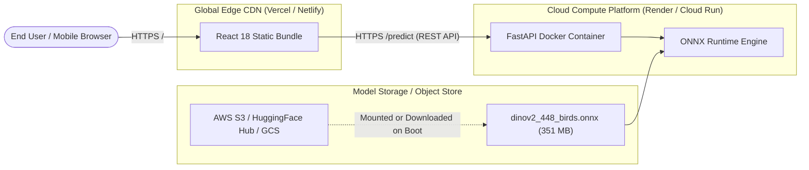

# BirdVision AI — Global Production Deployment Guide

This guide details the deployment architecture for transitioning **BirdVision AI** from localhost to global cloud hosting.

---

## 1. Cloud Architecture Overview



---

## 2. Frontend Deployment (Vercel or Netlify)

The React frontend is built as a static Single Page Application (SPA) with zero server-side rendering dependencies, making it suitable for edge distribution.

### Option A: Deploying on Vercel
1. Push the repository to GitHub.
2. In the Vercel dashboard, click **Add New Project** and select your repository.
3. Set **Root Directory** to: `web_application/frontend`.
4. Configure Build Settings:
   - **Framework Preset:** Vite
   - **Build Command:** `npm run build`
   - **Output Directory:** `dist`
5. Configure Environment Variables:
   - `VITE_API_BASE_URL`: `https://your-backend-service.onrender.com` (your live FastAPI URL)
6. Click **Deploy**.

### Option B: Deploying on Netlify
1. Connect repository in Netlify.
2. Set **Base directory**: `web_application/frontend`.
3. Set **Build command**: `npm run build`.
4. Set **Publish directory**: `web_application/frontend/dist`.
5. Add a `_redirects` file in `public/` with:
   ```text
   /*    /index.html   200
   ```
6. Set `VITE_API_BASE_URL` in Netlify Site Configuration.

---

## 3. Backend Deployment (Render / Railway / Cloud Run)

### Hardware Sizing Requirements
- **Model Size:** 351 MB (`dinov2_448_birds.onnx`).
- **RAM Footprint:** ~1.2 GB to 1.8 GB during ONNX graph loading and batch inference.
- **CPU:** Minimum 1 vCPU (2+ vCPUs recommended for multi-request concurrency).
- **GPU (Optional):** NVIDIA T4 or L4 GPU if sub-40ms latency is required.

> [!WARNING]
> **Free Tier Limitations:** Free hosting tiers (such as Render Free 512 MB RAM) will trigger an Out-Of-Memory (OOM) kill when loading the 351 MB Vision Transformer graph. A minimum of a **Starter / 2GB RAM** container instance is required for stable execution.

---

### Deploying on Render (Docker Service)
1. In Render Dashboard, click **New +** $\to$ **Web Service**.
2. Select **Docker** environment.
3. Set **Root Directory** to `web_application/backend`.
4. Instance Type: Select **Starter** (2 GB RAM or higher).
5. Environment Variables:
   ```env
   PORT=8000
   ENVIRONMENT=production
   DEBUG=False
   ALLOWED_ORIGINS=https://birdvision-ai.vercel.app,http://localhost:5173
   ```
6. Health Check Path: `/health`.

---

## 4. Handling Model Weights in Production CI/CD

Because Git repositories should avoid storing large binary weights (> 100 MB), use one of the following production patterns:

### Pattern A: Docker Multi-Stage Download on Boot
In `Dockerfile`, use `curl` or `huggingface_hub` to pull the verified ONNX model during container startup:
```dockerfile
# In backend Dockerfile:
RUN pip install huggingface_hub
RUN python -c "from huggingface_hub import hf_hub_download; hf_hub_download(repo_id='username/birdvision-dinov2', filename='dinov2_448_birds.onnx', local_dir='/models/exports')"
```

### Pattern B: Cloud Object Storage (AWS S3 / GCS)
Store `dinov2_448_birds.onnx` in a private S3 bucket. During container entrypoint initialization, download the weight file to `/tmp/models/` if not already present on local disk.

---

## 5. Production Security Checklist

- [x] **CORS Enforcement:** Set `ALLOWED_ORIGINS` to exact frontend domain names (disable `*` wildcard in production).
- [x] **File Size Limits:** FastAPI middleware enforces `MAX_UPLOAD_SIZE_MB = 20`.
- [x] **MIME Validation:** Strictly rejects non-image MIME types.
- [x] **Path Safety:** No local file paths or server directory structures are exposed through API errors or JSON responses.
- [x] **EXIF Transposition:** Neutralizes image orientation metadata before tensor feeding.
