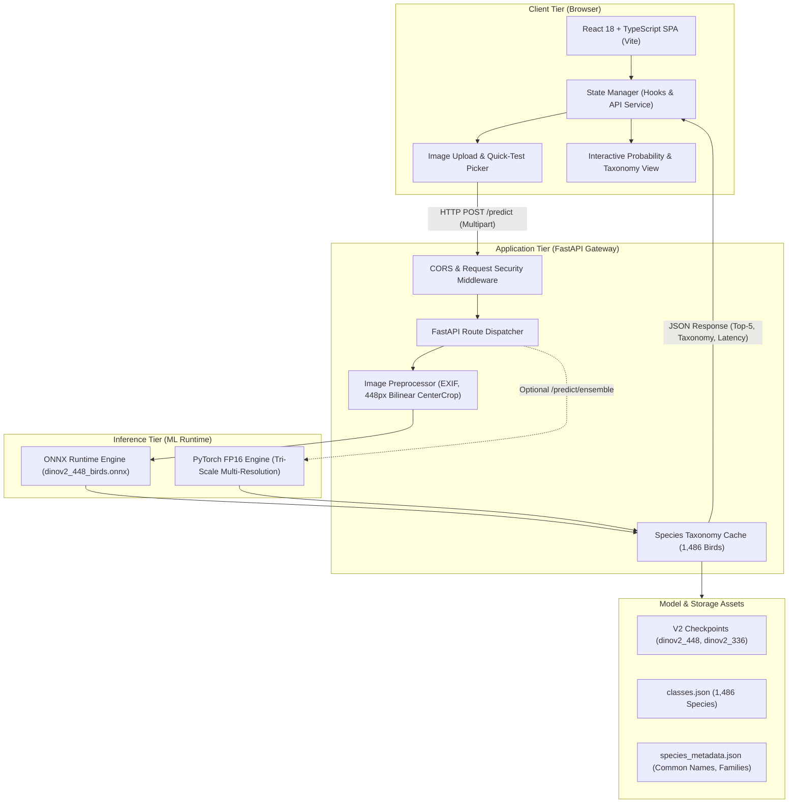
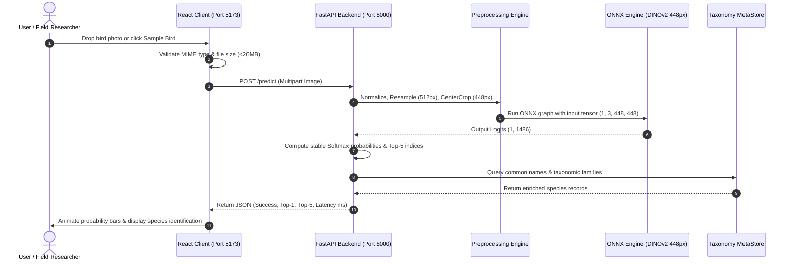

# BirdVision AI — System Architecture & Technical Specification

This document details the architectural layout, data flows, model inference pipelines, and deployment topology of **BirdVision AI**, an AI-powered avian biodiversity classification system recognizing 1,486 bird species with 80.03% Top-1 accuracy.

---

## 1. High-Level Architecture Overview

---

## 2. Component Breakdown

### A. Frontend Tier (React.js, TypeScript, Vite, Tailwind CSS)
- **Framework:** React 18.2 with TypeScript 5.2.
- **Styling:** Tailwind CSS with a wildlife palette (deep forest greens `#14532d`, `#166534`, and night slate `#0f172a`).
- **Icons:** Lucide React icons (`Bird`, `Sparkles`, `Cpu`, `Layers`, `ShieldCheck`).
- **Visualizations:** Recharts bar charts comparing empirical accuracies across 8 experimental model architectures.
- **Key Modules:**
  - `Navbar.tsx`: Real-time backend connectivity badge, smooth route navigation.
  - `Hero.tsx`: Core value proposition, 4 architectural metric highlights.
  - `ImageUploader.tsx`: Drag-and-drop file ingestion, client-side format & 20MB size verification, engine selection switch (ONNX vs Ensemble).
  - `SamplePicker.tsx`: 6 pre-loaded avian samples (*Buteo lagopus*, *Tyto alba*, *Acanthis flammea*, *Dryobates pubescens*, *Aythya collaris*, *Archilochus colubris*) for instant 1-click evaluation.
  - `PredictionResultCard.tsx`: Highlights top predicted species, confidence percentage, Linnaean taxonomic chips (Order, Family, Genus), Top-5 probability bars, and external links to iNaturalist / Wikipedia.
  - `SpeciesDirectory.tsx`: Searchable catalog with family filtering and pagination across all 1,486 species.
  - `ModelArchitectureSection.tsx`: ViT attention explanation, high-resolution patch mechanics, and empirical accuracy progression.
  - `AboutSection.tsx`: Problem statement, sister-species error analysis, and bioacoustic roadmap.

### B. Backend Tier (FastAPI, Python 3.11, Uvicorn)
- **Framework:** FastAPI with asynchronous lifespan initialization.
- **Startup Lifecycle:** Pre-loads the ONNX runtime model and taxonomy mapping into memory once during application bootstrap (`lifespan` context manager), guaranteeing zero cold-start delay during inference requests.
- **Validation Pipeline:**
  - Validates file MIME types (`image/jpeg`, `image/png`, `image/webp`).
  - Rejects empty payloads and files exceeding 20 MB.
  - Parses EXIF orientation tags to prevent camera rotation distortions.
  - Applies bilinear resampling to 512px shorter dimension, followed by a 448×448 center crop and ImageNet normalization ($\mu = [0.485, 0.456, 0.406], \sigma = [0.229, 0.224, 0.225]$).
- **Service Layer (`inference_service.py`):**
  - **Single-Model Engine:** High-throughput ONNX Runtime executing `exports/dinov2_448_birds.onnx`. Delivers **79.60% Top-1 / 91.12% Top-5** at ~25–35 ms latency on GPU (~350 ms on CPU).
  - **Ensemble Engine:** PyTorch FP16 Tri-Scale Ensemble executing multi-resolution inference at 448px, 392px, and 336px. Delivers **80.03% Top-1 / 91.22% Top-5** at ~115 ms latency.
  - **Taxonomic Enrichment:** Translates raw output indices directly into scientific names, common vernacular names, taxonomic families, orders, and iNaturalist taxon IDs.

---

## 3. Data Flow Sequence

---

## 4. Deployment Topologies

### Topology 1: Localhost Development (Current)
- Backend: Uvicorn on `http://localhost:8000` (backed by local `venv` with CUDA GPU or CPU execution).
- Frontend: Vite dev server on `http://localhost:5173` (with hot module replacement).
- Execution: Managed via `start_all.bat`.

### Topology 2: Docker Containerized Local / Staging
- Backend Container: Python 3.11 Slim with ONNX Runtime, model weights mounted via read-only volume (`exports:/models/exports:ro`).
- Frontend Container: Multi-stage build (Node 20 builder $\to$ Nginx Alpine edge server on port 80).
- Orchestration: `docker-compose up --build`.

### Topology 3: Cloud Microservices (Production)
- Frontend: Deployed on **Vercel** or **Netlify** with CDN edge caching, pointing to production API via `VITE_API_BASE_URL`.
- Backend: Deployed on a container platform with persistent volume storage (e.g., **Render**, **Railway**, **Google Cloud Run**, or **AWS ECS**) providing at least 2 GB RAM for the ONNX inference graph.
